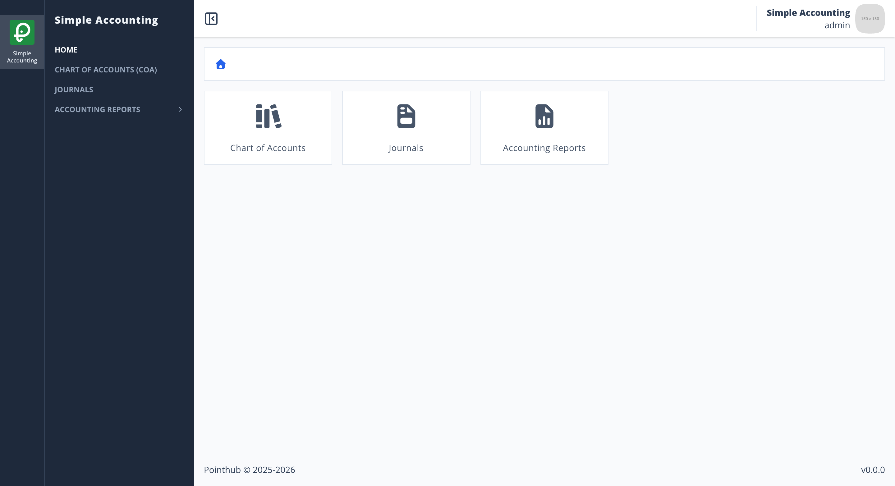
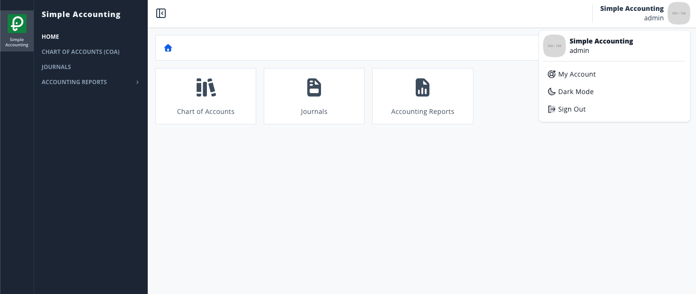

# Scenario 1.4. Signout

## 1.4.S1. Signout succeeds.

- `GIVEN` user already logged in
- `AND` user visit home

{.potrait-img}

- `WHEN` user click account menu in top-right corner
- `AND` user click button "signout"

{.potrait-img}

- `THEN` user redirected to page "signin"

{.potrait-img}