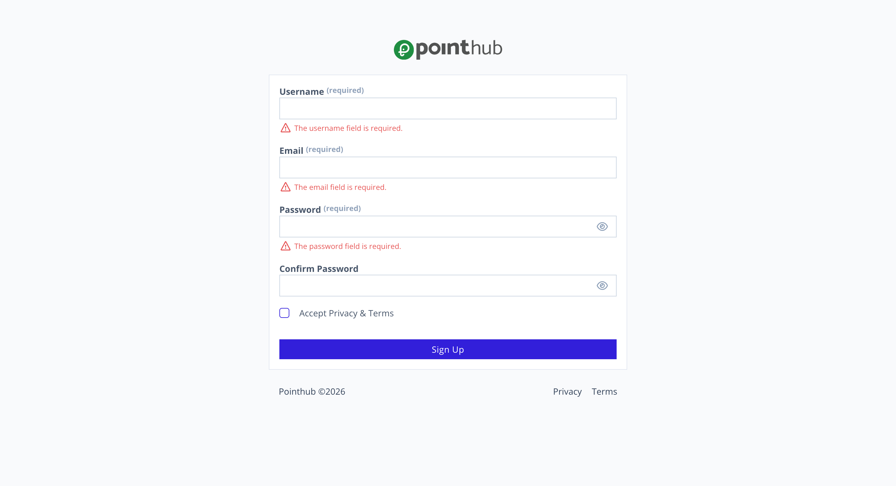

# Scenario 1.1. Signup

## 1.1.F1. Signup fails when required fields are empty.

- `GIVEN` user visit signup page
- `WHEN` user click button "sign-up"

{.potrait-img}

- `THEN` user see "The username field is required"
- `AND` user see "The email field is required"
- `AND` user see "The password field is required"

{.potrait-img}

