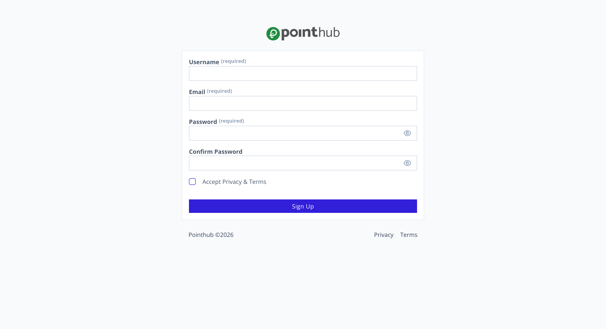
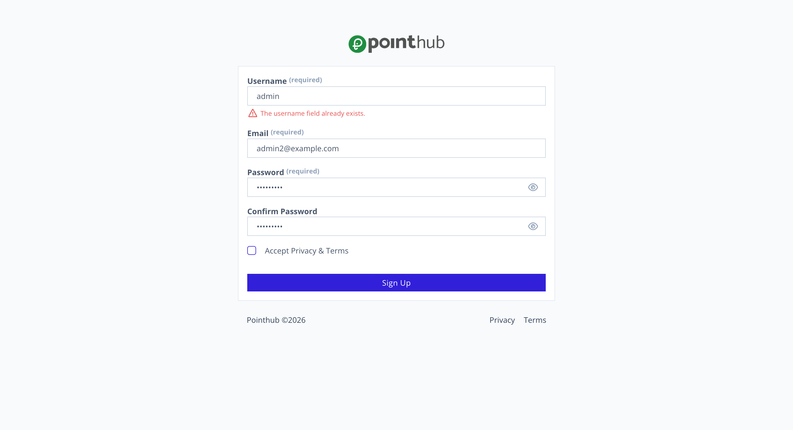

# Scenario 1.1. Signup

## 1.1.F2. Signup fails when username already exists.

- `GIVEN` user visit signup page

{.potrait-img}

- `WHEN` user type "admin" into input "username"
- `AND` user type "admin2@example.com" into input "email"
- `AND` user type "admin1234" into input "password"
- `AND` user type "admin1234" into input "confirm-password"
- `AND` user click button "sign-up"
- `THEN` user see "The username field already exists"

{.potrait-img}

